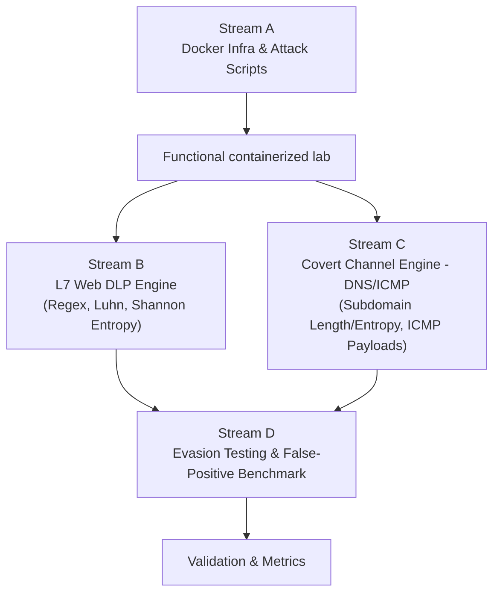

# IDEA 2: Network Data Loss Prevention

**Pitch:** Data Loss Prevention systems must detect unauthorized data exfiltration, whether through direct application transfers (credit card numbers, API credentials) or stealthy covert network channels (DNS/ICMP tunnels).

**Main Question:** What is the detection efficacy and false-positive profile of a deterministic network gateway combining content inspection (regex, entropy) with protocol behavioral analysis to block both web-based leaks and covert tunneling?

## Goal & Scope

**Goal:** Deploy a containerized network security gateway that detects and blocks data exfiltration across two distinct channels:

- **Application Layer (L7 Web):** Identification of structured and unstructured plaintext secrets (credit card numbers validated via Luhn algorithm, PEM-encoded private keys, high-entropy API tokens).
- **Covert Network Channels:** Identification of stealthy out-of-band exfiltration using DNS queries (entropy and length anomalies in subdomains) and ICMP packets (oversized or non-standard payloads in echo requests).

### HTTPS Handling

| Option | Approach |
|---|---|
| **A (Recommended): mitmproxy** | The DLP gateway runs mitmproxy with a custom Python inspection script. The test client trusts the gateway's generated CA certificate: outbound HTTPS traffic is intercepted, analyzed, and dropped upon leak detection. |
| **B: TLS-Offloading Assumption** | Web traffic is tested over HTTP, documented under the enterprise assumption that the DLP engine sits directly downstream of an enterprise SSL/TLS termination appliance. Covert channel inspection (DNS/ICMP) operates at the packet level regardless. |

## Technical Architecture & Docker Deployment

The environment deploys via a single `docker compose up` command, behaving identically on Linux and Windows/WSL2.

## Tasks & Workstreams

| Workstream | Scope | Owners |
|---|---|---|
| **A** — Docker Infrastructure & Exfiltration Generators (Offense) | Containerized lab, attack scripts | Antoine, Diogo |
| **B** — Application Layer Web Inspection Engine (L7 Defense) | Regex, Luhn, Shannon Entropy | Diogo, Jonas |
| **C** — Covert Channel Detection Engine (DNS & ICMP Defense) | Subdomain length/entropy, ICMP payload analysis | Sofia, Antoine |
| **D** — Evasion Techniques & False-Positive Benchmarking | Validation & metrics | — |

## Tools & Technical Stack

- **Orchestration:** Docker Compose (guarantees full environment parity across Linux and Windows)
- **Interception & Networking:** mitmproxy (Python API), scapy (packet sniffing/forging)
- **Languages:** Python 3 (`re`, standard math library for Shannon entropy, scapy)
- **Hardware:** Zero hardware required

## Testing Methodology & Success Metrics

- **Detection Matrix:** Run a test suite of 20 distinct scenarios (10 exfiltration attacks spanning Web, DNS, and ICMP; 10 benign enterprise traffic patterns).
- **Evaluation Metrics:** True Positive Rate (detection accuracy), False Positive Rate (critical for DLP deployability), and added gateway latency per request.

## Expected Deliverables

- Git repository containing the container setup (`docker-compose.yml` operational via `docker compose up`)
- Source code for inspection engines (mitmproxy addon + scapy covert channel detector)
- Automated attack scripts for replicating test scenarios
- `README.md`: architectural topology, formal detection rules, evasion test results, and individual contribution write-ups

## Critical Analysis

**Strengths**
- Practical defense implementation
- Balance between offense (attack scripts) and defense (inspection engines)
- Zero cross-platform compatibility friction via Docker Compose

**Weaknesses**
- Higher initial code volume than Idea 1 (requires writing both attack generators and detection logic)

**Pain Points**
- When implementing HTTPS interception via mitmproxy, the client container must trust the auto-generated CA certificate (`mitmproxy-ca-cert.pem`) to avoid TLS validation errors